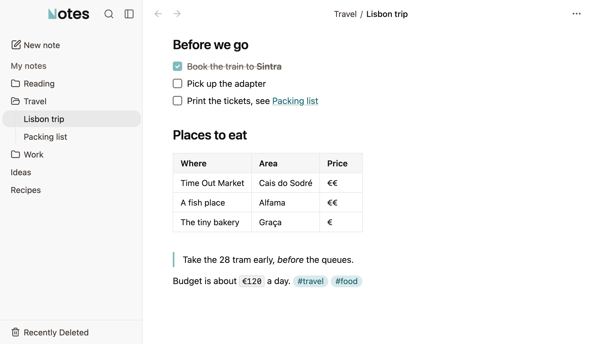

<h1>
  <picture>
    <source media="(prefers-color-scheme: dark)" srcset="assets/boojy-notes-lockup-dark.svg">
    
  </picture>
</h1>

### A calm place for the notes you own.

Boojy Notes is a free notes app for your desktop. Your notes are plain Markdown files in a folder you choose, so there's no account and nothing to export. It opens an existing Obsidian vault as it is.

[Download](https://boojy.org/notes/) · [Website](https://boojy.org) · [Changelog](CHANGELOG.md) · [Feedback](mailto:tyr@boojy.org)

[](https://github.com/boojyorg/boojy-notes/releases/latest)

<picture>
  <source media="(prefers-color-scheme: dark)" srcset="assets/screenshots/notes-dark.png">
  
</picture>

## About

- **Your files.** Ordinary `.md` files in a folder you choose, even one in iCloud Drive or Dropbox.
- **Writing.** Type `/` for any block, or the Markdown you already know: `#`, `-`, `**bold**`. Tables, code, maths and pictures too.
- **Finding.** Search with ⌘P, tags, and `[[links]]` between notes.
- **Safe on a folder you care about.** Editing one part of a file never rewrites the rest, and syntax the app doesn't understand is left alone ([the full promise](docs/SPEC-markdown-source-of-truth.md)). Every note keeps its version history, and Recently Deleted holds notes for 30 days.

## Status

Boojy Notes is in Beta, on macOS, Windows and Linux. I use it every day, and what I bump into decides what I fix next. An Android app on the same editor is in testing.

On Windows the installer isn't signed yet, so Windows warns about an unknown publisher. Choose More info, then Run anyway.

<details>
<summary><b>Development</b></summary>

You need Node.js 22 and pnpm (`corepack enable pnpm`).

```sh
pnpm install
pnpm dev        # the desktop app (Electron)
pnpm dev:web    # browser-only dev server, for fast UI iteration
```

The desktop app is the product. The browser build is a development target: quick to reload, handy for tests, and its notes live in browser storage rather than on disk.

| Script           | Description                                                |
| ---------------- | ---------------------------------------------------------- |
| `dev`            | Vite dev server + Electron                                 |
| `dev:web`        | Vite dev server (browser only)                             |
| `build`          | Production build (web)                                     |
| `build:electron` | Production build + desktop installers, into `release/`     |
| `test`           | Unit tests (Vitest)                                        |
| `test:coverage`  | Unit tests with the CI coverage floor                      |
| `test:e2e`       | Web end-to-end tests (Playwright)                          |
| `test:electron`  | Real desktop app against a temp vault                      |
| `check`          | Biome lint + format in one pass                            |
| `typecheck`      | TypeScript check (`tsc --noEmit`)                          |
| `screenshots`    | The README and website screenshots, into `assets/`         |
| `dev:phone`      | Vite dev server for the Android app, on port 5175          |
| `android`        | Builds and installs the Android app (`--live`: dev server) |

All scripts run via `pnpm <script>`. CI gates every push on `check`, `typecheck`, `test:coverage`, `test:e2e` and `test:electron`, plus a dependency audit at high severity; `test` alone is not the gate. Architecture, conventions and the things that will bite you are in [AGENTS.md](AGENTS.md); remaining work is in [docs/BACKLOG.md](docs/BACKLOG.md).

Built with React 19 and Vite 8, Electron 44 for the desktop shell, Vitest and Playwright for tests, Biome for lint and format, pnpm for packages.

</details>

## Contributing

I'm not taking code contributions right now. [CONTRIBUTING.md](CONTRIBUTING.md) says how to send feedback and bug reports.

## Licence

GNU General Public License v3.0. See [LICENSE](LICENSE). Copyright (c) 2025–2026 Tyr Bujac.
